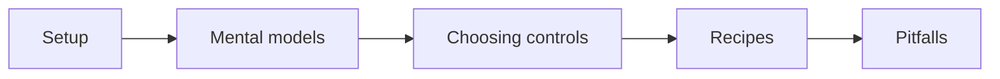

# What the library is

`@atom-forge/ui` is a Svelte 5 component library on Tailwind CSS 4, aimed at admin interfaces and dashboards. It covers far more than inputs and buttons:

| Area | Examples |
|---|---|
| Forms | Field, Input, Select, DatePicker, TagEditor |
| Data | Table, charts, Heatmap, Timeline, sortable lists |
| Overlays | Modal, Drawer, Popup, Toast, ContextMenu, command palette |
| Content | Prose, Doc, Markdown/Block/Table/Diagram editors |
| Scheduling | Calendar, Gantt, Organizer, ResourceManager |

The full, task-ordered list is the [capability map](https://github.com/atom-forge/ui/blob/main/docs/guides/component-overview.md#choose-by-task).

## What it does not do

The library renders and handles interaction. It does **not** fetch data, validate business rules, persist state, or authorize anything. A bound value is local UI state, not a saved record. Every composition guide ends with an *Application responsibilities* list; read it before shipping.

## How to read this book

Read in order once; later, jump to [[04-choosing-controls]] or [[06-pitfalls]].
