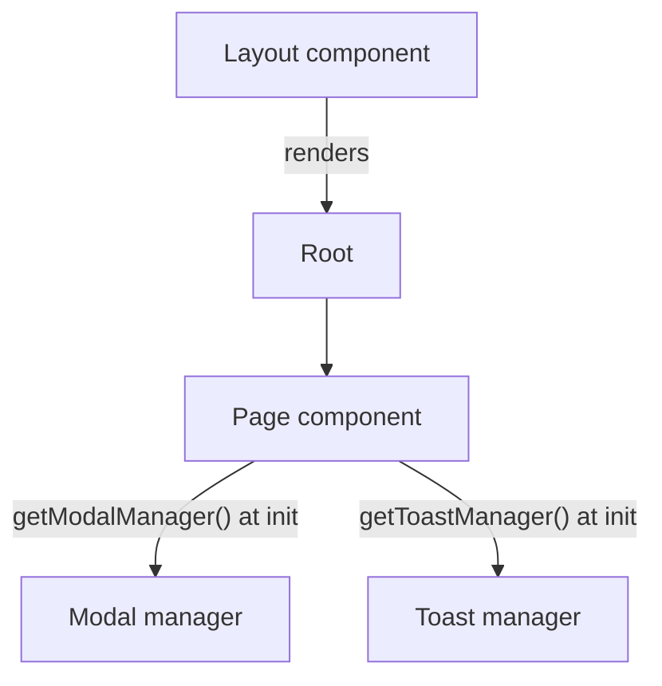

# Mental models

Three ideas explain most of the library's behavior.

## 1. Root provides context; descendants consume it

`Root` creates the theme state and the Modal, Drawer, Popup, and Toast managers, plus their containers.

A component that merely *renders* `Root` is not inside it. Call context getters in a **descendant**, during initialization, and use the returned manager later in event handlers.

![[../docs/guides/getting-started#Overlay managers]]

## 2. Overlays are managers, not components

`Modal` is not a `<Modal>` tag. You call `modal.open(Component, props)` and `await` a result. Dismissal may resolve with `undefined`, so only an explicit value should authorize an action. Each overlay has its own result contract; see [Overlays](https://github.com/atom-forge/ui/blob/main/docs/guides/overlays.md#select-by-task).

## 3. Semantic color tokens

Colors come in pairs (`bg-surface` with `text-surface-contrast`) that flip meaning between light and dark. Never hardcode Tailwind scales or hex values.

![[../docs/guides/color-system#Core Philosophy: The Contrast Model]]

![[../docs/guides/color-system#Surface Hierarchy]]

## The common thread: you own the application

Controls present and interact. Fetching, validation, persistence, permissions, and accessibility gaps stay with the application. Each recipe in [[05-recipes]] ends with an explicit list.
